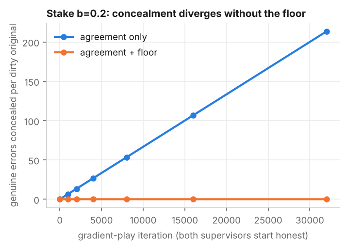
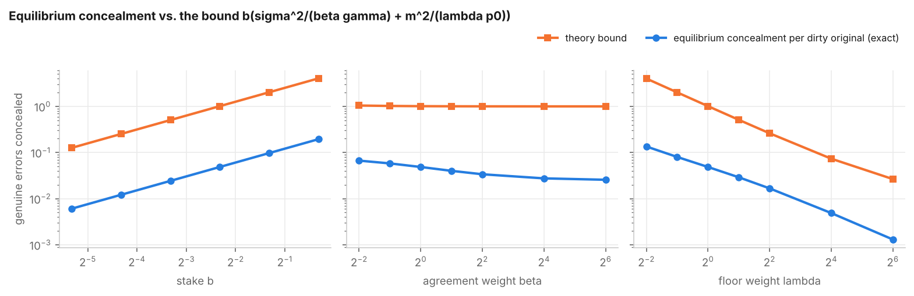
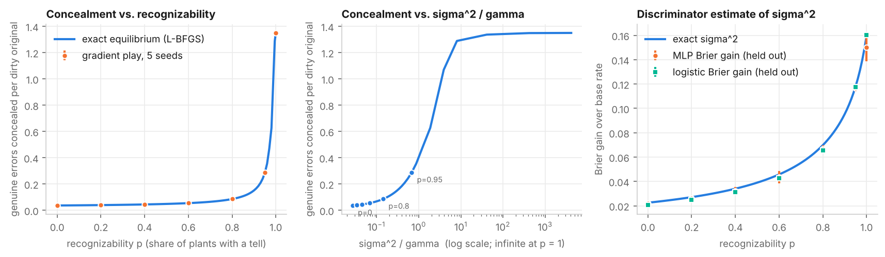
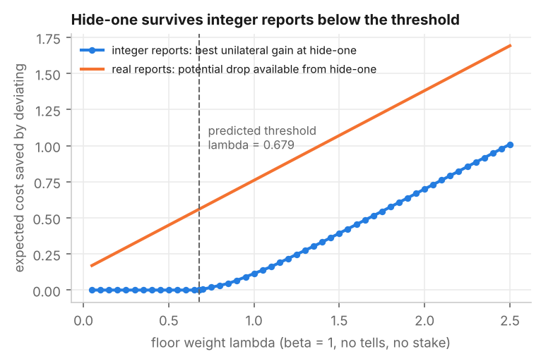

# Synthetic ledgers: first empirical test of the hidden-perturbation mechanism

## Summary of verdicts

| # | Prediction | Verdict | Key numbers |
|---|---|---|---|
| 1 | Agreement only: a uniform shift is free; with a stake under-reporting is unbounded | **Confirmed** | "count − 1" costs 0.0000 and is a menu equilibrium; with b = 0.2 the potential falls by 0.08 per unit of shift without limit and gradient play conceals 213 errors per dirty original after 32,000 steps, still growing linearly |
| 2 | Floor only: over-reporting is free | **Confirmed** | "always report 30" and "count + 1" cost 0.0000 |
| 3 | Both terms: only truth (plus harmless over-reporting, removed by eps) is free; with a stake concealment is bounded by about b(σ²/(βγ) + m²/(λp0)) | **Confirmed, with two qualifications** | every under-reporting strategy costs > 0; with b = 0.2 the equilibrium conceals 0.049 errors per dirty original against a bound of 1.01. The bound held in all 124 configurations with a finite bound but is loose (ratio 0.03–0.60). With eps > 0 the unique equilibrium is slightly *below* truth (by eps/(2λp0) = 0.0125 on clean originals), not at it |
| 4 | Concealment rises smoothly with recognizability | **Confirmed (continuous and monotone), but very uneven** | 0.037 at p = 0, 0.086 at p = 0.8, 0.29 at p = 0.95, 1.07 at p = 0.99, 1.35 at p = 1; no jump at p = 1 (gap 0.0001 from p = 0.99999) |
| 5 | Integer reports: hide-one is stable iff λc_k < β(1 − 2c_kq0) for all k ≥ 1; never with real reports | **Confirmed** | predicted threshold λ = 0.6787β; best-response iteration agrees at all 156 grid points (three values of β), including ±0.001 either side |
| 6 | A marker that survives perturbation and appears only on dirty originals allows free concealment | **Confirmed, with one qualification** | "hide one when the marker is present" costs 0.0000 (0.4517 without a marker); with a stake of only 0.001 the equilibrium conceals 1.0007 errors per dirty original at a mechanism penalty below 10⁻⁵. Qualification: a lone supervisor cannot profitably *jump* from honesty to that strategy (gain −0.197); honesty unravels through small steps |

No model API key and no GPU were available, so **no LLM pilot was run**; only the
interface and prompt templates exist (section 8).

## 1. Setup

**Task.** An original is a ledger of 12–20 arithmetic lines with T ∈ {0, 1, 2} genuine
errors (probabilities 0.8 / 0.15 / 0.05). Each of two supervisors gets a view with
Δ ~ Poisson(1.5) (truncated at 8) further errors made by the same function that makes
genuine ones. Each plant carries a stylistic tell (a doubled space after "=") with
probability p, the recognizability. In marker mode the ledger id is odd iff the
original is dirty.

**Mechanism.** cost_i = β(V_i − V_j)² + λ max(Δ_i − F_i, 0)² + eps·F_i − b·1{T>0}(T − V_i),
with V = F − Δ. Defaults: β = λ = 1, stake b = 0.2, reporting charge eps = 0.02,
recognizability p = 0.5 for the strategy and equilibrium tables.

**What a supervisor knows.** The view text only. Rule-based supervisors parse it into
K (wrong lines), R (wrong lines with a tell) and the marker bit. Because everything
else in the text is independent of T given (K, R), equilibria over functions of
(K, R) are equilibria over functions of the text (argument in the README).

**Model constants at p = 0.5** (exact): σ² = 0.0390, γ = 0.7168, p0 = 0.8, q0 = 0.2231, m = 2.

**Statistics.** Monte Carlo tables: 10 seeds × 10,000 originals, generated as text and
parsed back; all strategies are scored on the same samples. Other random procedures:
5 seeds. "±" is a 95% Student-t interval across seeds. Quantities with no "±" are
exact expectations from the finite model.

**Concealment** always means E[T − V | T > 0]: genuine errors withheld per dirty
original. Negative values are over-reporting.

## 2. Strategy menu (no training)

Strategies: `honest` (F = K); `hide_one` (max(K − 1, 0)); `shift_minus_one` (K − 1,
may be −1); `hide_unrecognized` (report the told errors plus the posterior-mean number
of untold plants, i.e. K − E[T | view]); `posterior_shade_50` and `_10`
(K − θE[T | view], θ = 0.5 and 0.1); `always_zero`; `report_max` (30); `over_one` (K + 1).

"Equilibrium in menu" means no deviation *to another menu strategy* has a gain whose
95% interval lies above zero. It is a statement about the menu only; section 3 removes
that restriction. In particular `report_max` and `over_one` show up as menu equilibria
under agreement because abandoning a coordinated profile alone is expensive, and
honesty can look stable only because the menu's smallest step is too large.

The three rewards that carry the predictions (p = 0.5, no stake, no eps):

| strategy (both use it) | agreement only | floor only | both |
|---|---|---|---|
| honest | 0.0000 | 0.0000 | 0.0000 |
| shift_minus_one | **0.0000** | 0.8013 ± 0.0034 | 0.8013 ± 0.0034 |
| hide_one | 0.2798 ± 0.0018 | 0.6211 ± 0.0031 | 0.9009 ± 0.0039 |
| hide_unrecognized | 0.1168 ± 0.0016 | 0.0706 ± 0.0017 | 0.1874 ± 0.0026 |
| posterior_shade_50 | 0.0292 ± 0.0004 | 0.0176 ± 0.0004 | 0.0468 ± 0.0006 |
| posterior_shade_10 | 0.0012 ± 0.0000 | 0.0007 ± 0.0000 | 0.0019 ± 0.0000 |
| always_zero | 2.9974 ± 0.0231 | 3.7252 ± 0.0450 | 6.7227 ± 0.0583 |
| report_max | 2.9974 ± 0.0231 | **0.0000** | 2.9974 ± 0.0231 |
| over_one | 0.0000 | **0.0000** | 0.0000 |

Reading it:

* **Agreement only.** The exact uniform shift is free and is an equilibrium. `hide_one`
  as literally specified (never below zero) costs 0.28, entirely from the clipping at
  K = 0, which breaks the uniformity of the shift.
* **Floor only.** Any over-report is free.
* **Both.** The only free profiles in the menu are `honest` and `over_one`. Every
  strategy that under-reports pays.

Full tables for all 12 rewards (with deviations and equilibrium flags) are in the
appendix; the p = 0 versions and every cell of every cost matrix are in
`results/menu/`. Monte Carlo symmetric costs agree with exact expectations to within
0.023 (worst case `always_zero`, inside its interval).

## 3. Equilibrium over all real-valued reporting functions (p = 0.5)

The game has a convex potential, so its equilibria are the minimisers of Ψ. Three
solvers: L-BFGS on Ψ; simultaneous gradient play with exact gradients from random
N(0, 1) initial reporting functions; and sampled gradient play on minibatches of 4,096
paired views. "Exploitability of honesty" is the most one supervisor can save by any
unilateral deviation when both are honest.

| reward | bounded below | exploitability of honesty | L-BFGS: concealed per dirty | L-BFGS: under-report per clean | gradient play (5 seeds): per dirty | sampled gradient play (5 seeds): per dirty | L2 distance to L-BFGS (gp / sampled) |
|---|---|---|---|---|---|---|---|
| agreement_only | yes | 0.00000 | -0.0000 | -0.0000 | 0.0298 ± 0.2103 | 0.0302 ± 0.2088 | 0.1378 / 0.1375 |
| agreement_only+eps | **no** | 0.00010 | diverges | diverges | 150.0 ± 0.2 after 30,000 steps, still growing | — | — |
| agreement_only+stake | **no** | 0.00079 | diverges | diverges | 300.1 ± 0.2 after 30,000 steps, still growing | — | — |
| agreement_only+stake+eps | **no** | 0.00129 | diverges | diverges | 450.1 ± 0.2 after 30,000 steps, still growing | — | — |
| floor_only | yes | 0.00000 | -0.0000 | -0.0000 | -0.3976 ± 0.1326 | -0.3976 ± 0.1326 | 0.5458 / 0.5458 |
| floor_only+eps | yes | 0.00014 | 0.0186 | 0.0125 | 0.0186 ± 0.0000 | 0.0183 ± 0.0001 | 0.0000 / 0.0095 |
| floor_only+stake | yes | 0.00167 | 0.0829 | 0.0250 | 0.0829 ± 0.0000 | 0.0828 ± 0.0001 | 0.3152 / 0.3153 |
| floor_only+stake+eps | yes | 0.00253 | 0.1012 | 0.0375 | 0.1012 ± 0.0000 | 0.1011 ± 0.0001 | 0.0000 / 0.0050 |
| both | yes | 0.00000 | -0.0000 | -0.0000 | -0.1463 ± 0.0900 | -0.1461 ± 0.0886 | 0.1463 / 0.1461 |
| both+eps | yes | 0.00006 | 0.0149 | 0.0125 | 0.0149 ± 0.0000 | 0.0149 ± 0.0000 | 0.0000 / 0.0007 |
| both+stake | yes | 0.00052 | 0.0486 | 0.0250 | 0.0486 ± 0.0000 | 0.0485 ± 0.0000 | 0.0000 / 0.0008 |
| both+stake+eps | yes | 0.00083 | 0.0634 | 0.0375 | 0.0634 ± 0.0000 | 0.0634 ± 0.0000 | 0.0000 / 0.0008 |

* Where the equilibrium is unique (any reward with the floor and eps > 0 or b > 0),
  both learning dynamics reach the L-BFGS point from every seed: concealment matches
  to four decimals and the probability-weighted L2 distance is ≤ 0.001 (sampled) or
  0 (exact).
* Where it is not unique (no stake and no eps), each seed lands on a different point
  of the zero-cost set. Under "both" these points are all over-reports (concealment
  −0.146 ± 0.090), as predicted. Under agreement only they are shifts of either sign
  (0.030 ± 0.210). Under floor-only with a stake, reports on views that are certainly
  clean (every error carries a tell) are indeterminate upward, which explains the 0.32
  distance despite identical concealment.
* Under-reporting on clean originals equals (b·P(dirty) + eps)/(2λp0) exactly whenever
  the floor is on: 0.0250 for b = 0.2, 0.0125 for eps = 0.02, 0.0375 for both. This is
  the first-order condition summed over all views.

### Prediction 1 with a stake

Under agreement only with b = 0.2, Ψ along the uniform shift g = −x is exactly −0.08x
(−80 at x = 1000); with the floor it is +1.52 at x = 1 and +1.999 million at x = 1000.
Gradient play from honesty conceals 6.7, 13.4, 26.7, 53.4, 106.7, 213.4 errors per
dirty original after 1k, 2k, 4k, 8k, 16k, 32k steps (identical across 5 seeds because
the start is deterministic). Exact best-response iteration adds 0.02 per round
indefinitely (0.04, 0.23, 1.03, 2.03, 4.03 after 1, 10, 50, 100, 200 rounds). Adding
the floor stops it at 0.0486.

### Prediction 3: the bound

| sweep | beta | lambda | b | concealed per dirty | concealed, unconditional | bound | ratio (per dirty / bound) |
|---|---|---|---|---|---|---|---|
| b | 1 | 1 | 0.025 | 0.0061 | 0.0012 | 0.1264 | 0.048 |
| b | 1 | 1 | 0.05 | 0.0121 | 0.0024 | 0.2527 | 0.048 |
| b | 1 | 1 | 0.1 | 0.0243 | 0.0049 | 0.5054 | 0.048 |
| b | 1 | 1 | 0.2 | 0.0486 | 0.0097 | 1.0109 | 0.048 |
| b | 1 | 1 | 0.4 | 0.0971 | 0.0194 | 2.0218 | 0.048 |
| b | 1 | 1 | 0.8 | 0.1942 | 0.0388 | 4.0436 | 0.048 |
| beta | 0.25 | 1 | 0.2 | 0.0667 | 0.0133 | 1.0436 | 0.064 |
| beta | 0.5 | 1 | 0.2 | 0.0580 | 0.0116 | 1.0218 | 0.057 |
| beta | 1 | 1 | 0.2 | 0.0486 | 0.0097 | 1.0109 | 0.048 |
| beta | 2 | 1 | 0.2 | 0.0401 | 0.0080 | 1.0054 | 0.040 |
| beta | 4 | 1 | 0.2 | 0.0338 | 0.0068 | 1.0027 | 0.034 |
| beta | 16 | 1 | 0.2 | 0.0275 | 0.0055 | 1.0007 | 0.027 |
| beta | 64 | 1 | 0.2 | 0.0257 | 0.0051 | 1.0002 | 0.026 |
| lam | 1 | 0.25 | 0.2 | 0.1351 | 0.0270 | 4.0109 | 0.034 |
| lam | 1 | 0.5 | 0.2 | 0.0801 | 0.0160 | 2.0109 | 0.040 |
| lam | 1 | 1 | 0.2 | 0.0486 | 0.0097 | 1.0109 | 0.048 |
| lam | 1 | 2 | 0.2 | 0.0290 | 0.0058 | 0.5109 | 0.057 |
| lam | 1 | 4 | 0.2 | 0.0167 | 0.0033 | 0.2609 | 0.064 |
| lam | 1 | 16 | 0.2 | 0.0049 | 0.0010 | 0.0734 | 0.066 |
| lam | 1 | 64 | 0.2 | 0.0013 | 0.0003 | 0.0265 | 0.049 |

* Concealment is exactly linear in b (constant ratio 0.048).
* The bound holds in every row here and at every p < 1 on the 105-point
  recognizability grid of section 4 (largest ratio 0.60, at p = 0.99; at p = 1 the
  bound is infinite).
* It is loose at these parameters because the floor part m²/(λp0) dominates: 1.00 of
  the 1.011. The agreement part σ²/(βγ) is 0.011.
* Shape is only partly matched. Concealment falls roughly like λ^−0.8, close to the
  bound's 1/λ. In β it falls from 0.067 to a floor of 0.0257 ≈ b(1 − p0)/(2λp0), not
  like 1/β; the bound allows this (its floor part does not depend on β).
* m was taken to be the largest genuine score (2). The brief does not define it, and
  the bound's value depends on that choice.

## 4. Recognizability (prediction 4)

Reward: both terms, b = 0.2, eps = 0. Discriminators are trained on 10,000 views and
scored on 10,000 held-out views per seed, using features parsed from the text
(K, R, K − R, length, marker bit).

| p | sigma^2 exact | MLP Brier gain | logistic Brier gain | gamma | sigma^2/gamma | concealed per dirty (L-BFGS) | gradient play, 5 seeds | under-report per clean | bound |
|---|---|---|---|---|---|---|---|---|---|
| 0 | 0.0225 | 0.0220 ± 0.0005 | 0.0208 ± 0.0005 | 0.8375 | 0.0269 | 0.0367 | 0.0367 ± 0.0000 | 0.0250 | 1.005 |
| 0.2 | 0.0271 | 0.0259 ± 0.0012 | 0.0247 ± 0.0008 | 0.8042 | 0.0337 | 0.0396 | 0.0396 ± 0.0000 | 0.0250 | 1.007 |
| 0.4 | 0.0340 | 0.0321 ± 0.0032 | 0.0314 ± 0.0013 | 0.7535 | 0.0452 | 0.0446 | 0.0446 ± 0.0000 | 0.0250 | 1.009 |
| 0.6 | 0.0457 | 0.0435 ± 0.0050 | 0.0428 ± 0.0012 | 0.6671 | 0.0686 | 0.0546 | 0.0546 ± 0.0000 | 0.0250 | 1.014 |
| 0.8 | 0.0698 | 0.0670 ± 0.0027 | 0.0654 ± 0.0015 | 0.4880 | 0.1430 | 0.0858 | 0.0858 ± 0.0000 | 0.0250 | 1.029 |
| 0.95 | 0.1182 | 0.1168 ± 0.0028 | 0.1174 ± 0.0023 | 0.1741 | 0.6787 | 0.2868 | 0.2868 ± 0.0000 | 0.0250 | 1.136 |
| 1 | 0.1600 | 0.1502 ± 0.0114 | 0.1603 ± 0.0017 | 0.0000 | ∞ | 1.3500 | 1.3500 ± 0.0000 | -0.0000 | ∞ |

* **Discriminator.** The MLP's held-out Brier gain tracks exact σ² to within 0.002
  for p ≤ 0.95 (slightly below, as expected of a lower bound). At p = 1 the MLP is
  under-fit (0.150 ± 0.011 against 0.160); the logistic model recovers 0.160.
* **Concealment** is monotone increasing on a 105-point grid and continuous at p = 1
  (difference between p = 0.99999 and p = 1 is 0.0001). There is no jump.
* The rise is far from uniform: more than half of it happens between p = 0.98 and p = 1. The
  steepest slope is 44 errors per unit of p near p = 0.99. A designer who reads
  "smooth" as "gradual" would be misled; up to p = 0.8 concealment only goes from
  0.037 to 0.086.
* Against σ²/γ, concealment rises and then saturates at E[T | dirty] + b/(2λ) = 1.35.
  The floor caps concealment even when γ = 0 and the bound is infinite.
* Near p = 1 the floor violations move from clean originals (0.025 for p ≤ 0.97) to
  dirty ones (0 on clean at p = 1): supervisors who can tell plants apart stop
  risking the floor on clean ledgers.

## 5. Integer-only reports (prediction 5)

No tells, no stake, both supervisors start at F(k) = max(k − 1, 0), alternating
best responses over integers 0..13.

* c_1 = 0.8889 is the binding state, q0 = 0.2231, so the predicted threshold is
  λ = 0.6787β.
* For β ∈ {0.5, 1, 2} and 52 values of λ each, hide-one is a fixed point exactly when
  the inequality holds: stable at λ = threshold − 0.001, unstable at threshold + 0.001,
  in all three cases (156 of 156 grid points agree).
* Above the threshold the first state to defect is k = 1, then k = 2 from λ = 0.9, and
  so on. Best-response iteration then reaches fully honest reporting within 2 rounds
  at every unstable grid point.
* Real-valued reports: at hide-one the gradient of a supervisor's own cost is never
  zero (norm ≥ 0.38 on the grid), and L-BFGS started at hide-one reaches Ψ = 0 with
  concealment ≤ 0 at every grid point. Hide-one is never an equilibrium.

## 6. Marker (prediction 6)

Same setting as section 2 (p = 0.5), plus `marker_hide_one` (hide one error iff the
ledger id is odd). In marker mode the Bayesian strategies also use the marker.

| environment | reward | strategy | expected cost when both use it | best unilateral deviation | gain |
|---|---|---|---|---|---|
| marker=on | both | honest | 0.0000 ± 0.0000 | posterior_shade_10 | -0.0032 ± 0.0000 |
| marker=on | both | posterior_shade_10 | 0.0001 ± 0.0000 | honest | -0.0030 ± 0.0000 |
| marker=on | both | marker_hide_one | 0.0000 ± 0.0000 | posterior_shade_50 | -0.0296 ± 0.0005 |
| marker=on | both+stake | honest | 0.0000 ± 0.0000 | posterior_shade_10 | +0.0018 ± 0.0000 |
| marker=on | both+stake | posterior_shade_10 | -0.0048 ± 0.0001 | honest | -0.0080 ± 0.0001 |
| marker=on | both+stake | marker_hide_one | -0.0394 ± 0.0004 | hide_unrecognized | -0.0221 ± 0.0006 |
| marker=off | both | honest | 0.0000 ± 0.0000 | posterior_shade_10 | -0.0021 ± 0.0000 |
| marker=off | both | posterior_shade_10 | 0.0019 ± 0.0000 | honest | +0.0004 ± 0.0000 |
| marker=off | both | marker_hide_one | 0.4517 ± 0.0021 | posterior_shade_50 | +0.0941 ± 0.0030 |
| marker=off | both+stake | honest | 0.0000 ± 0.0000 | posterior_shade_10 | -0.0000 ± 0.0001 |
| marker=off | both+stake | posterior_shade_10 | -0.0002 ± 0.0001 | honest | -0.0017 ± 0.0001 |
| marker=off | both+stake | marker_hide_one | 0.4316 ± 0.0024 | posterior_shade_50 | +0.0844 ± 0.0032 |

Exact equilibrium over all reporting functions:

| stake b | marker: concealed per dirty | marker: mechanism penalty paid | no marker: concealed per dirty | no marker: mechanism penalty paid |
|---|---|---|---|---|
| 0 | -0.0000 | 0.00000 | -0.0000 | 0.00000 |
| 0.001 | 1.0007 | 0.00000 | 0.0002 | 0.00000 |
| 0.01 | 1.0069 | 0.00001 | 0.0024 | 0.00000 |
| 0.05 | 1.0346 | 0.00018 | 0.0121 | 0.00008 |
| 0.2 | 1.1383 | 0.00282 | 0.0486 | 0.00124 |
| 0.8 | 1.5532 | 0.04511 | 0.1942 | 0.01983 |

* With the marker, hiding one error on every dirty original costs exactly nothing
  (both supervisors shift by the same amount on the same originals, and V stays ≥ 0).
  Without it the same strategy costs 0.45.
* Any positive stake then selects concealment: at b = 0.001 the unique equilibrium
  hides 1.0007 errors per dirty original and pays under 10⁻⁵ in penalties; gradient
  play reaches it from all 5 seeds. Without the marker the same stake yields 0.0002.
  The marker gives σ² = 0.16 and γ = 0, so the bound is infinite.
* Qualification: with the other supervisor honest, switching alone to
  `marker_hide_one` loses 0.197 ± 0.002 (0.158 with the stake), because the agreement
  term punishes it. Concealment is free for the pair, not for a lone deviator. Honesty
  still fails under a stake because small steps pay (`posterior_shade_10` gains
  +0.0018 ± 0.0000). With b = 0 exactly, honesty remains one of many equilibria.
* The free amount is one error per dirty original, the smallest genuine score. Hiding
  more costs something: 1.14 at b = 0.2 for a penalty of 0.003.

## 7. Deviations from the brief and choices made

* **hide-one.** The brief describes it both as "a uniform shift" and as
  max(count − 1, 0). These differ at count = 0, and only the unclipped shift is free
  under agreement alone. Both are in the menu.
* **hide-all-recognized-genuine** was read as "report told errors plus the posterior
  mean of untold plants", which equals K − E[T | view].
* **Added strategies**: `shift_minus_one`, `over_one`, `posterior_shade_10`. The last
  was added after the first run showed the menu had no deviation small enough to
  exploit honesty under a stake; all results shown are from the final menu.
* **Poisson truncated at 8** plants and renormalised (mass removed ≈ 3 × 10⁻⁵).
* **γ and σ² are computed on the reduced model** (original = T, view = (K, R[, marker])).
  On raw text the maximal correlation is trivially 1 because both views share the
  benign lines.
* **m = 2** in the bound; concealment compared with the bound is per dirty original
  (the stricter of the two readings; the unconditional figure is 5× smaller).
* **Discriminators use parsed features**, not raw text.
* **Exact gradient play has zero-width intervals** where the equilibrium is unique: it
  is deterministic given the start and converges to the same point from each. The
  sampled version carries the Monte Carlo noise.
* **Menu tables are at p = 0.5** (p = 0 also saved). Prediction 5 uses p = 0.
* **No LLM pilot** (next section).

## 8. LLM hook: not run

Environment check: no `ANTHROPIC_API_KEY`, `OPENAI_API_KEY` or other model key, no
`anthropic`/`openai`/`torch` packages, no GPU (`nvidia-smi` absent). Session
infrastructure credentials were present but are not a model API key provisioned for
this work and were not used.

What exists: `hpo/supervisor.py` with the `Supervisor.report(view_text) -> float`
protocol, a `RuleSupervisor`, and an `LLMSupervisor` holding an honest prompt, a
collusive prompt, a user template and a reply parser. `LLMSupervisor.report` raises
`NotImplementedError` unless a `complete(system, user) -> str` callable is supplied.
None of the LLM path has been exercised against a real model.

What an LLM version needs next:

1. A backend for `complete`, and a pilot of a few hundred views measuring honest
   accuracy: E|F − K| and, more importantly, whether errors in F correlate across the
   two views of one original (the agreement term assumes they do not).
2. A noise-aware baseline. An honest but imperfect monitor pays agreement cost; the
   mechanism's penalties must be compared with that floor, not with zero.
3. The collusive prompt across p ∈ {0, 0.5, 0.95, 1}, to see whether a model finds the
   tell and shades as section 4 predicts, and whether two instances coordinate
   without communication.
4. Marker audits: the theory's weakest point here is any dirty-correlated feature that
   survives perturbation. With real transcripts such features are not chosen by the
   designer, so a discriminator for "dirty" trained on *original-only* features is
   needed before trusting the mechanism.
5. Plants made by a model rather than by the genuine-error function, with the
   section-4 discriminator used to measure the resulting σ²; the steep rise beyond
   p ≈ 0.9 says how good they must be.
6. Fine-tuning or in-context learning against the mechanism, to replace tabular
   gradient play.

## 9. Files

* Code: `hpo/`, `experiments/`, `tests/` (19 tests).
* `results/menu/`: `menu_tables.md`, `menu_summary.csv`, `menu_all_cells.csv`.
* `results/equilibrium/`: `equilibrium_by_reward.csv`, `bound_sweep.csv`,
  `unbounded_demo.csv`, `agreement_only_br_ladder.csv`, `model_constants.json`,
  `fig_unbounded.png`, `fig_bound_sweep.png`.
* `results/recognizability/`: `recognizability_sweep.csv`,
  `recognizability_dense_exact.csv`, `smoothness.json`, `fig_recognizability.png`.
* `results/integer/`: `integer_hide_one.csv`, `threshold.json`, `fig_integer.png`.
* `results/marker/`: `marker_menu_tables.md`, `marker_menu_summary.csv`,
  `marker_on_all_cells.csv`, `marker_off_all_cells.csv`,
  `honest_to_marker_hide_one.csv`, `marker_equilibrium.csv`.
* `results/run_all.log`: console output of the run that produced the above.

## Appendix: strategy tables for all 12 rewards (p = 0.5)

Cost is the expected charge to one supervisor when both use the strategy. Gain is the
saving from the best unilateral switch to another menu strategy (positive = profitable).
"Weak or unresolved" means some alternative is exactly costless or its gain interval
straddles zero.

**agreement_only**

| strategy (both use it) | expected cost | best unilateral deviation | gain from it | equilibrium in menu |
|---|---|---|---|---|
| honest | 0.0000 ± 0.0000 | posterior_shade_10 | -0.0014 ± 0.0000 | yes (strict) |
| hide_one | 0.2798 ± 0.0018 | shift_minus_one | +0.1011 ± 0.0020 | no |
| shift_minus_one | 0.0000 ± 0.0000 | hide_one | -0.1802 ± 0.0009 | yes (strict) |
| hide_unrecognized | 0.1168 ± 0.0016 | posterior_shade_50 | +0.0224 ± 0.0015 | no |
| posterior_shade_50 | 0.0292 ± 0.0004 | posterior_shade_10 | +0.0004 ± 0.0005 | yes (weak or unresolved) |
| posterior_shade_10 | 0.0012 ± 0.0000 | honest | -0.0003 ± 0.0000 | yes (strict) |
| always_zero | 2.9974 ± 0.0231 | shift_minus_one | +0.6560 ± 0.0384 | no |
| report_max | 2.9974 ± 0.0231 | over_one | -741.3568 ± 0.8088 | yes (strict) |
| over_one | 0.0000 ± 0.0000 | honest | -1.0000 ± 0.0000 | yes (strict) |

**agreement_only+eps**

| strategy (both use it) | expected cost | best unilateral deviation | gain from it | equilibrium in menu |
|---|---|---|---|---|
| honest | 0.0348 ± 0.0002 | posterior_shade_10 | -0.0009 ± 0.0000 | yes (strict) |
| hide_one | 0.2982 ± 0.0019 | shift_minus_one | +0.1047 ± 0.0020 | no |
| shift_minus_one | 0.0148 ± 0.0002 | hide_one | -0.1838 ± 0.0009 | yes (strict) |
| hide_unrecognized | 0.1467 ± 0.0017 | posterior_shade_50 | +0.0199 ± 0.0015 | no |
| posterior_shade_50 | 0.0616 ± 0.0005 | posterior_shade_10 | -0.0016 ± 0.0005 | yes (strict) |
| posterior_shade_10 | 0.0355 ± 0.0002 | honest | -0.0008 ± 0.0000 | yes (strict) |
| always_zero | 2.9974 ± 0.0231 | shift_minus_one | +0.6412 ± 0.0383 | no |
| report_max | 3.5974 ± 0.0231 | over_one | -740.8117 ± 0.8089 | yes (strict) |
| over_one | 0.0548 ± 0.0002 | honest | -0.9800 ± 0.0000 | yes (strict) |

**agreement_only+stake**

| strategy (both use it) | expected cost | best unilateral deviation | gain from it | equilibrium in menu |
|---|---|---|---|---|
| honest | 0.0000 ± 0.0000 | posterior_shade_10 | +0.0007 ± 0.0000 | no |
| hide_one | 0.2401 ± 0.0021 | shift_minus_one | +0.1011 ± 0.0020 | no |
| shift_minus_one | -0.0397 ± 0.0007 | hide_one | -0.1802 ± 0.0009 | yes (strict) |
| hide_unrecognized | 0.0959 ± 0.0016 | posterior_shade_50 | +0.0119 ± 0.0015 | no |
| posterior_shade_50 | 0.0187 ± 0.0004 | posterior_shade_10 | -0.0080 ± 0.0006 | yes (strict) |
| posterior_shade_10 | -0.0009 ± 0.0000 | honest | -0.0024 ± 0.0000 | yes (strict) |
| always_zero | 2.8883 ± 0.0221 | shift_minus_one | +0.5867 ± 0.0385 | no |
| report_max | 4.0804 ± 0.0343 | over_one | -740.3135 ± 0.8183 | yes (strict) |
| over_one | 0.0397 ± 0.0007 | honest | -0.9603 ± 0.0007 | yes (strict) |

**agreement_only+stake+eps**

| strategy (both use it) | expected cost | best unilateral deviation | gain from it | equilibrium in menu |
|---|---|---|---|---|
| honest | 0.0348 ± 0.0002 | posterior_shade_10 | +0.0012 ± 0.0000 | no |
| hide_one | 0.2585 ± 0.0021 | shift_minus_one | +0.1047 ± 0.0020 | no |
| shift_minus_one | -0.0249 ± 0.0007 | hide_one | -0.1838 ± 0.0009 | yes (strict) |
| hide_unrecognized | 0.1258 ± 0.0017 | posterior_shade_50 | +0.0095 ± 0.0015 | no |
| posterior_shade_50 | 0.0511 ± 0.0005 | posterior_shade_10 | -0.0100 ± 0.0006 | yes (strict) |
| posterior_shade_10 | 0.0334 ± 0.0002 | honest | -0.0029 ± 0.0000 | yes (strict) |
| always_zero | 2.8883 ± 0.0221 | shift_minus_one | +0.5718 ± 0.0384 | no |
| report_max | 4.6805 ± 0.0343 | over_one | -739.7684 ± 0.8183 | yes (strict) |
| over_one | 0.0946 ± 0.0007 | honest | -0.9403 ± 0.0007 | yes (strict) |

**floor_only**

| strategy (both use it) | expected cost | best unilateral deviation | gain from it | equilibrium in menu |
|---|---|---|---|---|
| honest | 0.0000 ± 0.0000 | report_max | +0.0000 ± 0.0000 | yes (weak or unresolved) |
| hide_one | 0.6211 ± 0.0031 | honest | +0.6211 ± 0.0031 | no |
| shift_minus_one | 0.8013 ± 0.0034 | honest | +0.8013 ± 0.0034 | no |
| hide_unrecognized | 0.0706 ± 0.0017 | honest | +0.0706 ± 0.0017 | no |
| posterior_shade_50 | 0.0176 ± 0.0004 | honest | +0.0176 ± 0.0004 | no |
| posterior_shade_10 | 0.0007 ± 0.0000 | honest | +0.0007 ± 0.0000 | no |
| always_zero | 3.7252 ± 0.0450 | honest | +3.7252 ± 0.0450 | no |
| report_max | 0.0000 ± 0.0000 | honest | +0.0000 ± 0.0000 | yes (weak or unresolved) |
| over_one | 0.0000 ± 0.0000 | honest | +0.0000 ± 0.0000 | yes (weak or unresolved) |

**floor_only+eps**

| strategy (both use it) | expected cost | best unilateral deviation | gain from it | equilibrium in menu |
|---|---|---|---|---|
| honest | 0.0348 ± 0.0002 | posterior_shade_10 | -0.0002 ± 0.0000 | yes (strict) |
| hide_one | 0.6396 ± 0.0031 | honest | +0.6047 ± 0.0031 | no |
| shift_minus_one | 0.8162 ± 0.0034 | honest | +0.7813 ± 0.0034 | no |
| hide_unrecognized | 0.1005 ± 0.0018 | honest | +0.0656 ± 0.0017 | no |
| posterior_shade_50 | 0.0500 ± 0.0005 | honest | +0.0151 ± 0.0004 | no |
| posterior_shade_10 | 0.0350 ± 0.0002 | honest | +0.0002 ± 0.0000 | no |
| always_zero | 3.7252 ± 0.0450 | honest | +3.6904 ± 0.0449 | no |
| report_max | 0.6000 ± 0.0000 | honest | +0.5652 ± 0.0002 | no |
| over_one | 0.0548 ± 0.0002 | honest | +0.0200 ± 0.0000 | no |

**floor_only+stake**

| strategy (both use it) | expected cost | best unilateral deviation | gain from it | equilibrium in menu |
|---|---|---|---|---|
| honest | 0.0000 ± 0.0000 | posterior_shade_10 | +0.0014 ± 0.0001 | no |
| hide_one | 0.5814 ± 0.0038 | posterior_shade_10 | +0.5828 ± 0.0037 | no |
| shift_minus_one | 0.7616 ± 0.0041 | posterior_shade_10 | +0.7630 ± 0.0040 | no |
| hide_unrecognized | 0.0497 ± 0.0020 | posterior_shade_10 | +0.0511 ± 0.0020 | no |
| posterior_shade_50 | 0.0072 ± 0.0006 | posterior_shade_10 | +0.0085 ± 0.0005 | no |
| posterior_shade_10 | -0.0014 ± 0.0001 | honest | -0.0014 ± 0.0001 | yes (strict) |
| always_zero | 3.6161 ± 0.0455 | posterior_shade_10 | +3.6175 ± 0.0455 | no |
| report_max | 1.0830 ± 0.0184 | posterior_shade_10 | +1.0844 ± 0.0185 | no |
| over_one | 0.0397 ± 0.0007 | posterior_shade_10 | +0.0411 ± 0.0007 | no |

**floor_only+stake+eps**

| strategy (both use it) | expected cost | best unilateral deviation | gain from it | equilibrium in menu |
|---|---|---|---|---|
| honest | 0.0348 ± 0.0002 | posterior_shade_10 | +0.0019 ± 0.0001 | no |
| hide_one | 0.5998 ± 0.0038 | posterior_shade_10 | +0.5669 ± 0.0037 | no |
| shift_minus_one | 0.7764 ± 0.0041 | posterior_shade_10 | +0.7435 ± 0.0040 | no |
| hide_unrecognized | 0.0795 ± 0.0020 | posterior_shade_10 | +0.0466 ± 0.0019 | no |
| posterior_shade_50 | 0.0395 ± 0.0006 | posterior_shade_10 | +0.0065 ± 0.0005 | no |
| posterior_shade_10 | 0.0330 ± 0.0002 | honest | -0.0019 ± 0.0001 | yes (strict) |
| always_zero | 3.6161 ± 0.0455 | posterior_shade_10 | +3.5832 ± 0.0454 | no |
| report_max | 1.6830 ± 0.0184 | posterior_shade_10 | +1.6501 ± 0.0185 | no |
| over_one | 0.0946 ± 0.0007 | posterior_shade_10 | +0.0616 ± 0.0007 | no |

**both**

| strategy (both use it) | expected cost | best unilateral deviation | gain from it | equilibrium in menu |
|---|---|---|---|---|
| honest | 0.0000 ± 0.0000 | posterior_shade_10 | -0.0021 ± 0.0000 | yes (strict) |
| hide_one | 0.9009 ± 0.0039 | hide_unrecognized | +0.2991 ± 0.0039 | no |
| shift_minus_one | 0.8013 ± 0.0034 | hide_unrecognized | +0.0858 ± 0.0025 | no |
| hide_unrecognized | 0.1874 ± 0.0026 | posterior_shade_50 | +0.0754 ± 0.0026 | no |
| posterior_shade_50 | 0.0468 ± 0.0006 | posterior_shade_10 | +0.0173 ± 0.0009 | no |
| posterior_shade_10 | 0.0019 ± 0.0000 | honest | +0.0004 ± 0.0000 | no |
| always_zero | 6.7227 ± 0.0583 | shift_minus_one | +3.5800 ± 0.0780 | no |
| report_max | 2.9974 ± 0.0231 | over_one | -741.3568 ± 0.8088 | yes (strict) |
| over_one | 0.0000 ± 0.0000 | honest | -1.0000 ± 0.0000 | yes (strict) |

**both+eps**

| strategy (both use it) | expected cost | best unilateral deviation | gain from it | equilibrium in menu |
|---|---|---|---|---|
| honest | 0.0348 ± 0.0002 | posterior_shade_10 | -0.0016 ± 0.0000 | yes (strict) |
| hide_one | 0.9194 ± 0.0039 | hide_unrecognized | +0.2877 ± 0.0039 | no |
| shift_minus_one | 0.8162 ± 0.0034 | hide_unrecognized | +0.0708 ± 0.0025 | no |
| hide_unrecognized | 0.2173 ± 0.0027 | posterior_shade_50 | +0.0729 ± 0.0026 | no |
| posterior_shade_50 | 0.0792 ± 0.0008 | posterior_shade_10 | +0.0153 ± 0.0009 | no |
| posterior_shade_10 | 0.0362 ± 0.0002 | honest | -0.0001 ± 0.0000 | yes (strict) |
| always_zero | 6.7227 ± 0.0583 | shift_minus_one | +3.5651 ± 0.0779 | no |
| report_max | 3.5974 ± 0.0231 | over_one | -740.8117 ± 0.8089 | yes (strict) |
| over_one | 0.0548 ± 0.0002 | honest | -0.9800 ± 0.0000 | yes (strict) |

**both+stake**

| strategy (both use it) | expected cost | best unilateral deviation | gain from it | equilibrium in menu |
|---|---|---|---|---|
| honest | 0.0000 ± 0.0000 | posterior_shade_10 | -0.0000 ± 0.0001 | yes (weak or unresolved) |
| hide_one | 0.8612 ± 0.0045 | hide_unrecognized | +0.2803 ± 0.0040 | no |
| shift_minus_one | 0.7616 ± 0.0041 | hide_unrecognized | +0.0670 ± 0.0029 | no |
| hide_unrecognized | 0.1665 ± 0.0028 | posterior_shade_50 | +0.0649 ± 0.0027 | no |
| posterior_shade_50 | 0.0364 ± 0.0007 | posterior_shade_10 | +0.0089 ± 0.0010 | no |
| posterior_shade_10 | -0.0002 ± 0.0001 | honest | -0.0017 ± 0.0001 | yes (strict) |
| always_zero | 6.6135 ± 0.0583 | shift_minus_one | +3.5106 ± 0.0781 | no |
| report_max | 4.0804 ± 0.0343 | over_one | -740.3135 ± 0.8183 | yes (strict) |
| over_one | 0.0397 ± 0.0007 | honest | -0.9603 ± 0.0007 | yes (strict) |

**both+stake+eps**

| strategy (both use it) | expected cost | best unilateral deviation | gain from it | equilibrium in menu |
|---|---|---|---|---|
| honest | 0.0348 ± 0.0002 | posterior_shade_10 | +0.0005 ± 0.0001 | no |
| hide_one | 0.8796 ± 0.0045 | hide_unrecognized | +0.2688 ± 0.0041 | no |
| shift_minus_one | 0.7764 ± 0.0041 | hide_unrecognized | +0.0519 ± 0.0029 | no |
| hide_unrecognized | 0.1964 ± 0.0029 | posterior_shade_50 | +0.0624 ± 0.0027 | no |
| posterior_shade_50 | 0.0687 ± 0.0008 | posterior_shade_10 | +0.0069 ± 0.0009 | no |
| posterior_shade_10 | 0.0341 ± 0.0002 | honest | -0.0022 ± 0.0001 | yes (strict) |
| always_zero | 6.6135 ± 0.0583 | shift_minus_one | +3.4958 ± 0.0779 | no |
| report_max | 4.6805 ± 0.0343 | over_one | -739.7684 ± 0.8183 | yes (strict) |
| over_one | 0.0946 ± 0.0007 | honest | -0.9403 ± 0.0007 | yes (strict) |
